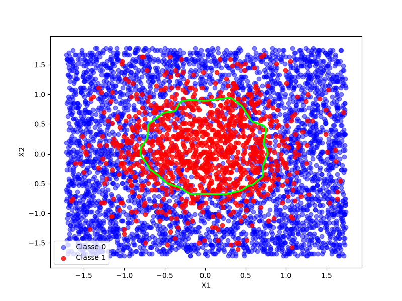

# Rebuilding-DL - Chapter 2 : First network


## Goal 

In the chapter 1, We've been able to separate a dataset which could be separated with a straight line. Now, what happens if the toxic ones were in a circle at the middle of our plot ? 


 


## Logic

We will assemble neurons in different size layers.
- Adding more neurons per layer let us draw borders with more faces
- Adding more layers let us assemble and fold these simple shapes to create non linear functions. 

## How to implement it ?


### Implementing the weights W and biasis b

For a ```L``` layer with ```N``` neurons, and ```E``` entries (number of neurons from the precedent layer or number of features if ```L``` is the first layer), ```W[L]``` is a 2D matrix, with ```E``` lines and ```N``` columns. ```b[L]``` is an array of ```N``` elements. 

### Prediction
Each ```L``` layer calculates  ```X[L] = A[L-1]*W[L]+b[L]``` and sends the result to its activation function, which calculates ```A[L]```, the entries of ```L+1```. 

### Training
Each ```L``` layer gets a ```dZ[L+1]``` (the error calculated by the next layer, multiplied by the derivative of ```L```'s activation function). It calculates the local gradient ```dZ[L] = dZ[L+1]*d_activation[L](Z)```.

With ```A[L-1]``` (the output of the precedent layer's activation), it calculates ```dW[L] = (1/m) * A[L-1] * dZ[L]``` and ```db[L] = (1/m) * sum(dZ[L])```. 

It updates its weights with a ```lr``` learning rate : ```W[L] = W[L] - lr*dW[L]``` and ```b[L] = b[L] - lr*db[L]```.

Finally, it sends ```dZ[L]``` to the ```L-1``` layer.

In practice, mathematically, the ```dZ[L] = dZ[L+1]*d_activation[L](Z)``` of the last layer with its sigmoid activation simplifies into  ```dZ[L] = A[L] - y```, which has been implemented here.

We also notice the ```weight``` parameter, which is useful in making non detection of the C class more heavier than non detecting the others. This is useful when the C class is under represented in the training dataset.

## Playing with the architecture

This code has been written to be able to modsify easily the number of layers, and the number of neurons per layer. We can play with that, with the ```lr``` learning rate, the ```weight```, the number of training iterations ```n_iter```, to try to optimize our model according to our case, or simply to look at effects on the shape of the separation.