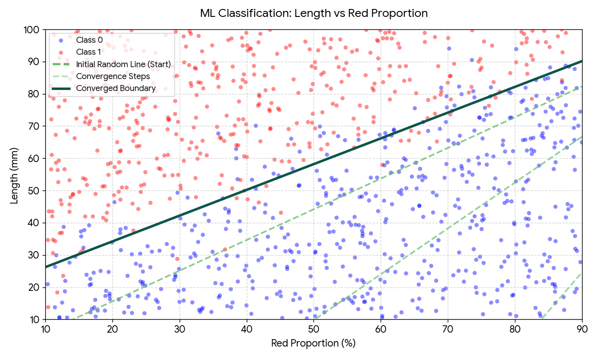
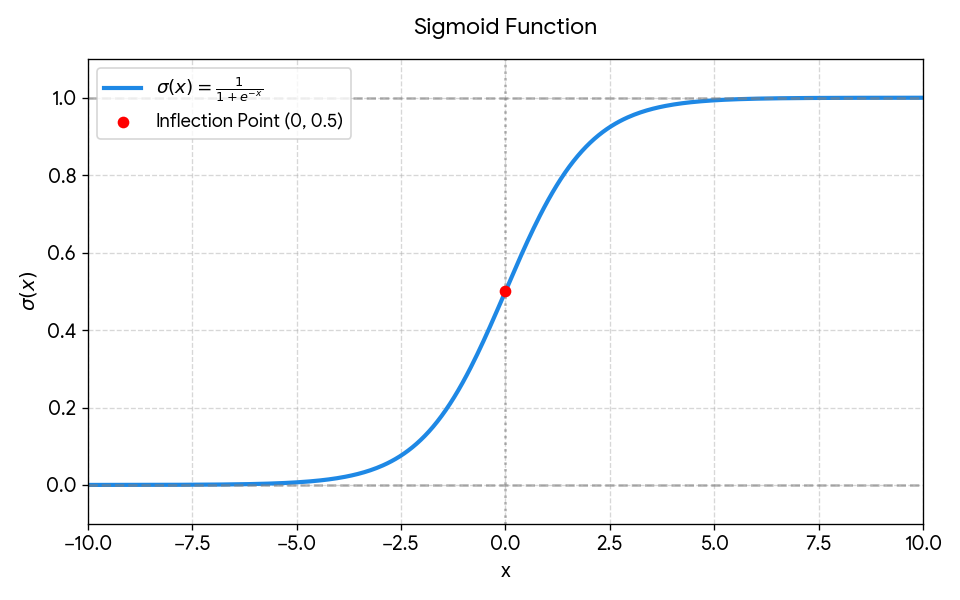

# Rebuilding-DL - Chapter 1 : 1 Neuron/activation

## Goal 

Imagine our goal is to predict if a mushroom is toxic. But what is a "mushroom" ? 

We can encode it as an element having :
- n features X1...Xn (numbers, for example length in mm, red, green, blue proportion in %, etc...)
- a toxicity label y. 1 if toxic, 0 if not.

The goal of the neuron is to be able to read the features and tell us if it is toxic or not.

## Logic

Imagine we have 1000 mushrooms examples in a dataset.
When we plot each one on a graphic length/red proportion, it seems that we could separate them with a straight line.

This line is  our neuron. A linear function such as : Z = sum( i=[1...n] | Xi*Wi) + b. 

The goal is to find the Wi and the b to make our linear function separate properly the toxic ones and the non toxic ones. 

 

How to convert our float output to a 2 choices output (toxic/non toxic) ? We will use an Activation function.

For what we want to do, the most common one is the sigmoid function. It takes a number, and send a toxicity probability between 0% and 100%.

We juste have to say that more than 50% is toxic, non toxic else.

## How to make our neuron truthful ?

We will train it. Here is the logic. We will repeat 20000 times :

- We give our 1000 mushrooms [X1...Xn] to the neuron. It will predict for each one a wrong toxicity y_pred.
- We compare to the true toxicities y of each one. We calculate each one's error with a loss function. We sum these errors.
- We give it back to our neuron as a feedback. It will say : "Okay. the last time, I moved the Wi weights from this value to this value. So, the error has moved from this to that.". It will let the neuron know how many it needs to move again the Wi weights to lower the error. The neuron does that for each W1...Wn and b biasis. 

Our line will move with little steps, until the error cannot be more reduced. This is the spot our line will be properly able to tell us if a new mushroom is toxic. 

## Important points

### Normalization

In our dataset, we can have some very big features (ex : a 15 mm mushroom) and very little ones (ex : a 0.5 red proportion). During training, if the algorithm decides that we need to adjust the W weights in an equitable way, the 15mm effect will erase the 0.5's one. It is too big. 

We need to make them all the same scale, as they cannot erase the others anymore. 

We will : 
- calculate the Xi_mean for each features in our dataset,
- calculate the Xi_standard_deviation for each feature,
- remove the mean and divide the result by the std to each Xi value.

