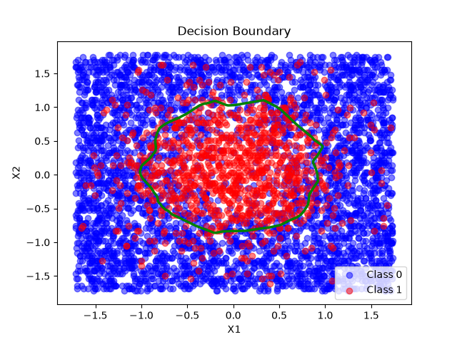
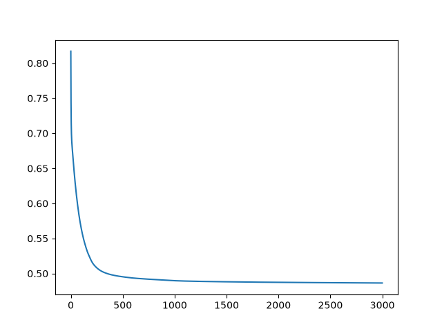

# Rebuilding-DL - Chapter 4 : Object based Network


## Goal 

Since now, we assumed, for ease, few hypothesis that will not be true all time. For instance, assuming that the last layer activation function is always a sigmoid, which makes possible to simplify the back propagation mathematical formula for last layer into ```y_pred-y``` in practical. Nonetheless, if we want to change the architecture, we will need to do all calculation by hand again. Or... implement a modular architecture. This is why Pytorch and TensorFlow decided to implement it in OOP. And we will do the same. 

 


## Logic

Each layer is now an independant object.
During a prediction, each neuron layer will keep in memory what it got in input, and what it sent in output.
During a back propagation, it will use this data to calculate its own coefficients derivates from the ```dA``` given by its following activation, update its ```W``` and ```b```, and transmit a ```dZ``` to the before's layer.

## Results : 

We got this : 



```
--- CONFUSION MATRIX ---
(TP) : 714
(TN) : 3518
(FP) : 450
(FN) : 318
----------------------------
(Accuracy) : 84.64%
(Precision)        : 61.34%
(Recall)              : 69.19%
```

These are the same results, for a same architecture, training dataset, and epochs numbers as the chapter 2's network, than it. We can validate the objectification of the neuronal network. 